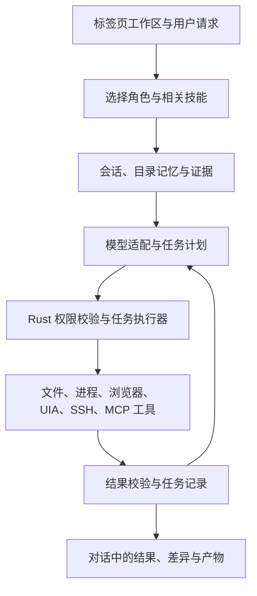

# Dalizi Files 智能体工作台开发方案

版本：评审稿 v1.5（同步 0.5.1 实现基线） · 日期：2026-11-03 · 技术基线：Rust + Tauri 2 + 原生 HTML/CSS/JavaScript · 目标平台：Windows 10 / Windows 11 x64。

本文汇总此前的功能需求、已完成改进和后续增强方向，并加入“开箱可用的基础技能与 Agent 角色”设计。**本文是开发规划，不代表下列规划功能已经接入程序。** 已实现状态以当前仓库代码为依据；具体使用说明见 [使用手册](USER_GUIDE.md)。

已落地范围：9 项内置文本技能、技能分组与能力提示、目录记忆整理、聊天摘要、目录级对话保存/恢复/导出、标签拖动/溢出滚动/误关恢复、本地双面板、密码压缩、便携偏好，以及 SSH 默认分屏、远程目录筛选、SFTP 批量与递归传输、同次运行内续传和复核重试。角色选择、通用工具执行层、任务事件日志、浏览器 Agent 与电脑操控仍为规划。后文各阶段的完整目标不因局部功能接入而自动视为完成。版本演进见 [更新记录](CHANGELOG.md)。

快速阅读：[当前基线](#2-当前实现基线) · [内置技能](#4-建议内置的基础技能) · [角色方案](#5-建议预置的-agent-角色) · [优先级总表](#11-全量增强方向与优先级) · [里程碑](#12-推荐里程碑) · [验收场景](#13-验收场景与指标)。

## 1. 产品目标与开发顺序

目标是一个以文件目录为工作区、集成文件管理、模型对话、本地开发、终端、远程连接和网页任务的 Windows 智能体工作台。用户可以直接选择“文件整理”“开发助手”“设计助手”等工作方式，也可以导入自己的技能。

建议的主线：

1. **基础技能与角色目录 + 会话和任务记录**：新用户无需自己编写技能；重启后可以继续查看任务。
2. **可审阅的文件修改与开发工具**：先读取证据，再生成差异、执行、测试和记录结果。
3. **浏览器与电脑操控**：在稳定的工具执行层之上接入，提供可观察、可停止的操作过程。
4. **远程工作区与外部工具**：扩展 SFTP、SSH 配置、MCP 和多角色协作。

文件管理性能、现代化交互、便携性与 Win10/Win11 验证贯穿各阶段。保持现有语言和前端框架；可以借鉴其他项目的调度、技能加载和上下文管理方法。

### 必须保留的产品约定

- 标签页中的目录决定当前本地工作区；切换到其他目录，不把前一个目录的记忆带过去。
- 本地工作记忆仍保存到该目录的 `.dalizi/agent-memory.json`；角色切换不创建另一套隐蔽的记忆目录。
- 文件预览和最右侧 Agent 对话分别使用自己的面板。浮动对话仍支持停靠。
- 保留“只读 / 确认后执行 / 自动执行（当前目录）”三种权限模式。
- 技能、角色、记忆和模型输出不能扩大执行权限。能力不足时明确说明缺少什么。
- 本地目录、远程主机路径和网页会话使用不同的工作区身份；不会因为同名路径而共享权限或记忆。
- 模型由用户配置。推理强度是模型请求参数，不代表切换成更高等级的模型。

## 2. 当前实现基线

“已有”指代码中已经提供；“部分”指已有基础但尚未形成完整工作流。本表不是所有目标 Windows 环境的验收声明。

| 能力 | 当前状态 | 后续需要补齐 |
| --- | --- | --- |
| 多标签文件浏览、本地双面板、虚拟列表、列拖动与属性 | 已有 | 本地/远端联合面板、本地批量任务进度、更多系统集成 |
| 文件夹大小缓存、持久索引、统一搜索类型 | 已有 | 索引范围管理、分页与更多过滤、可解释的缓存状态 |
| PDF、图片、文本、Word OOXML、表格预览 | 已有 | PDF 密码输入；DOCX/DOCM/DOTX/DOTM 正文；XLSX/XLSM/XLTX/XLTM/XLSB/CSV/TSV 的工作表切换与分页已接入。旧 DOC/XLS、ODS、图表和完整 Office 版式待做 |
| PowerShell 与 SSH 标签 | 已有 | 内置 SSH 默认展示终端/目录/主机概况，支持目录筛选、批量与递归传输及同次运行续传；跳板、转发和远端文件编辑待做 |
| SSH 错误恢复 | 已有 | Ctrl+C、断开/重连、PTY/Shell 异常与 SFTP 解耦、慢启动状态已完成，应持续回归 |
| WebView2 浏览器、拼图扩展面板、浏览器设置 | 已有 | 站点权限交互、自动化桥接、更多运行时兼容测试 |
| 路径/URL 历史、收藏夹栏、混合标签恢复与下载面板 | 已有 | 文件夹/网页按序自动或手动恢复已接入；终端/SSH 恢复与重新认证待做 |
| 最右侧 Agent 对话与浮动布局 | 已有 | 任务时间线、角色选择与能力说明 |
| 自定义接口、模型配置、推理强度 | 已有 | 能力探测、流式响应、实际请求取消、使用量统计 |
| 内置与自定义技能 | 已有基础库 | 9 项基础技能随程序提供，支持自定义 `SKILL.md` 快照；角色系统、自动推荐和引用资源按需加载待做 |
| 目录记忆、学习建议、记忆导入导出 | 已有 | 统计、自动精确去重与备份已接入；来源、语义冲突与版本管理待做 |
| 聊天上下文统计与自动摘要 | 已有 | 支持三种 API、取消、失败回退和随对话档案保存；真实模型用量与检索待做 |
| 多轮聊天 | 有界档案已接入 | 可选保存最近 60 条消息与摘要、重启查看/继续、Markdown 导出；完整任务事件日志仍待实现 |
| AI 文件动作 | 部分 | 当前仅允许 `mkdir / rename / move / copy`；copy 仅支持文件。尚不能读取正文、编辑代码、运行测试或任意命令 |
| 三种权限与执行校验 | 已有 | 新工具需要各自的资源范围与授权规则；不能直接复用目录自动权限控制整台电脑 |
| 电脑操控、浏览器 Agent、MCP、多 Agent 调度 | 规划 | 需要真正的工具后端与任务执行器 |
| 可复制运行 | 部分 | 已有可选便携 JSON 配置（通用偏好、AI 接口参数、网页收藏/历史）；目录记忆随项目迁移；技能、完整浏览器数据和凭据迁移仍需开发 |

基线证据：技能与记忆见 [agent_profile.rs](../src-tauri/src/agent_profile.rs)，内置正文见 [builtin-skills](../resources/builtin-skills)，AI 上下文、动作及权限见 [ai.rs](../src-tauri/src/ai.rs)，对话状态见 [ai.js](../ui/ai.js)。自定义技能最多保存 32 个，内置与自定义合计最多启用 4 个；导入不会运行脚本或自动读取引用文件。AI 当前取得的是目录与选中条目的元数据，界面能预览文件不代表模型已读取该文件正文。

当前本地终端的 AI 目录取终端启动目录，不跟随 shell 内的 `cd`；SSH 和网页标签还没有 AI 工作区。未来若支持终端目录跟踪，需要可信的 shell 集成与明确的目录变更提示，不能从不可信终端输出猜测路径后扩大操作范围。手动文件操作已有系统 Shell 撤销支持；AI 文件计划尚无应用级撤销日志，这两类恢复能力需分别验收。

## 3. 技能、角色与工具如何配合

| 对象 | 负责什么 | 示例 |
| --- | --- | --- |
| Skill（技能） | 可复用的操作方法、检查步骤与输出要求 | UI 设计评审、定位错误、整理下载目录 |
| Agent 角色 | 一组默认技能、任务目标与工具偏好 | 开发助手、设计助手、电脑操作助手 |
| 工具 | 实际读取、修改、运行或交互的能力，由 Rust 校验并执行 | 读取文本、应用补丁、启动进程、读取窗口、点击控件 |
| 模型适配器 | 把上下文和工具定义转换为服务商支持的请求 | 通用兼容接口、支持工具调用/图像输入的接口 |
| 任务执行器 | 管理步骤、确认、取消、结果与恢复 | 一次“修复问题并运行测试”的任务 |
| 记忆与会话 | 提供经过选择的偏好、历史和任务证据 | 本目录命名规范、上次测试结果 |

例如，“调试技能”可以规定先复现、再定位、再修改、最后验证；实际查看代码与运行测试分别依赖文件读取工具和进程工具。仅添加技能文字时，这个角色只能提供基于现有上下文的建议。

下面是目标架构，新增执行层尚未实现：



第一版角色按串行工作流实现。真正的并行子 Agent 需要额外的调度、取消、预算与写入冲突管理，后续单独验收。

## 4. 建议内置的基础技能

采用项目维护的工作流文本，随应用发布，离线可浏览。所有技能都应说明使用时机、需要的输入、操作步骤、结果格式和失败处理。内置库可以丰富，但每轮只加载相关的少量技能。

其中 `file-organize`、`task-planning`、`product-design`、`ui-design-review`、`software-development`、`debug-and-test`、`code-review`、`documentation`、`terminal-diagnostics` 已接入首批内置目录。文件整理复用现有受限动作，其他 8 项仅提供分析与建议；下表“建议阶段”仍描述各技能完整执行能力的目标。`document-analysis`、`browser-workflow`、`computer-use` 尚未上架。

| 技能 ID / 名称 | 典型任务与产物 | 所需能力 | 建议阶段 |
| --- | --- | --- | --- |
| `file-organize` 文件整理 | 分类、命名建议、可核对的移动/复制计划 | 现有目录元数据和受限文件动作 | 第一批可用 |
| `task-planning` 任务拆解 | 输出目标、步骤、依赖和验收条件 | 对话；后续接任务记录 | 第一批可用 |
| `product-design` 产品与交互设计 | 根据用户描述整理流程、状态、空态、错误恢复和可访问性要求 | 对话；实界面评估需要截图/页面读取 | 第一批提供建议 |
| `ui-design-review` 界面设计评审 | 布局、间距、层级、主题、键盘操作和窄窗检查 | 用户提供的描述；后续图像/DOM/UIA | 第一批提供建议 |
| `software-development` 软件开发 | 分析代码、制定修改、生成补丁并说明验证结果 | 文件读取/搜索、补丁、进程、任务记录 | 工具层完成后执行 |
| `debug-and-test` 调试与测试 | 复现、最小定位、修复、针对性验证 | 日志读取、文件工具、受控进程 | 工具层完成后执行 |
| `code-review` 代码审查 | 按证据给出问题位置、影响与建议，区分确认问题和推测 | 代码/差异读取；测试可选 | 工具层完成后完整提供 |
| `documentation` 文档编写 | README、开发方案、操作手册与变更说明 | 对话；保存文件需要写入工具 | 第一批提供内容草稿 |
| `document-analysis` 文档阅读 | 阅读 PDF/DOCX/文本，给出有来源位置的摘要 | 明确授权的正文提取工具及预算 | 文档工具阶段 |
| `terminal-diagnostics` 终端与 SSH 诊断 | 根据用户提供的错误分析连接、命令和环境问题 | 首版对话；主动检查需要进程/远程工具 | 第一批提供建议 |
| `browser-workflow` 网页操作 | 阅读页面、查找信息、填写表单并核对结果 | 指定网页标签的浏览器工具、站点范围 | 浏览器 Agent 阶段 |
| `computer-use` 电脑操控 | 读取指定窗口、操作控件、复查状态，必要时使用截图 | Windows UIA、窗口截图、输入控制 | 电脑 Agent 阶段 |

补充候选：表格分析、Git 工作流、SFTP 文件传输、项目记忆维护。等相应工具可用后再加入可执行技能目录，避免一次性堆入大量不可用入口。

### 每项技能的验收要求

- 有明确触发范围；与任务不相关时不加载。
- 能列出已使用的输入和产物；没有读取的文件不能声称已审阅，没有运行的测试不能声称通过。
- 工具不足时显示“仅提供建议”或具体缺失能力，而不是给出虚假的执行结果。
- 文件、网页、日志和技能引用内容作为任务数据处理，不赋予额外权限。
- 中英文名称与说明可切换；导入的原文保持不变。

## 5. 建议预置的 Agent 角色

角色是可切换的工作方式。用户无需理解实现细节，界面只呈现“擅长什么”“当前能做什么”“需要哪些授权”。

| 角色 | 默认技能组合（每轮仍受数量预算限制） | 首版定位 |
| --- | --- | --- |
| 通用助手 | 按需推荐 `task-planning`、`documentation` | 默认入口，不强制套用所有技能 |
| 文件整理助手 | `file-organize`、`task-planning` | 可结合现有动作执行 |
| 产品与设计助手 | `product-design`、`ui-design-review`、`documentation` | 先提供方案；有界面证据后进行实界面评审 |
| 开发助手 | `software-development`、`debug-and-test`、`documentation` | 文件与进程工具接入后执行开发任务 |
| 审查助手 | `code-review`、`debug-and-test` | 默认只读；需要修改时回到现有权限流程 |
| 终端与远程助手 | `terminal-diagnostics`、`task-planning` | 首版在本地对话分析用户提供的日志；SSH 标签的 Agent 入口与远程工具后续接入 |
| 网页助手 | `browser-workflow`、`document-analysis` | 绑定所选网页标签和站点范围 |
| 电脑操作助手 | `computer-use`、`task-planning` | 绑定明确选择的应用窗口，显示运行状态和停止入口 |

### 角色交互

1. 在对话顶部增加角色选择，保留模型和推理强度选择。
2. 技能管理分为“内置 / 我的技能”；可查看说明、启停、版本、依赖状态，支持复制内置技能为自定义版本。
3. 推荐技能显示原因，例如“本次请求涉及目录分类”。用户手动指定的技能优先，允许关闭自动推荐。
4. 不把全部内置技能默认发送给模型。建议保留每轮最多 4 个技能的预算；随着上下文管理成熟再评估调整。
5. 切换角色不会切换目录、修改记忆范围或提升权限；尚未执行的旧计划失效并需重新生成。正在执行任务时不改变该任务的角色快照；修改只影响后续任务。
6. 需要新执行能力的角色仍可展示介绍，但按钮应写清“仅建议”或“工具尚未接入”。

角色只更新本轮推荐组合，不直接修改已有自定义技能的全局启停。若用户已选择 4 项技能，角色推荐不能偷偷替换它们或额外加载：保留当前选择，展示待加入项与最终加载列表，由用户调整后再应用。某个技能只具备部分工具时，按步骤标注能力，例如“可以读取代码，暂不能修改或运行测试”，不将整项技能笼统判为全可用或全不可用。

## 6. 技能包与升级设计

建议兼容开放的 `SKILL.md` 目录结构：元数据与正文分离，可带按需读取的参考资料和资源。格式参考 [Agent Skills 规范](https://agentskills.io/specification)。该格式描述技能内容，具体能执行哪些工具仍由本程序决定。

建议新增目录（以下均为规划路径）：

```text
resources/
  builtin-skills/
    catalog.v1.json
    file-organize/SKILL.md
    product-design/SKILL.md
    software-development/SKILL.md
    computer-use/SKILL.md
    ...
  agent-roles.v1.json
```

第一批仅分发文本工作流和必要模板。Rust 通过编译期嵌入或受校验的应用资源加载，不能依赖开发机的绝对路径。用户的启停状态、个人副本和导入技能保存在可迁移的应用数据中。

当前首批实现已采用编译期嵌入 `SKILL.md` 和 Rust 目录元数据；未新增上例中的 JSON 目录清单、角色文件或按步骤工具依赖协议。内置技能默认关闭，正文不可由用户存储覆盖；用户导入与内置的启用数合并校验。用户配置位置保持不变，数据格式从 v1 迁移到 v2，首次写入前保留旧版原文备份。复制内置技能为自定义版本、资源按需加载和角色组合仍按后续方案实施。

建议的目录清单记录示例（项目自定义协议，不是现有 API）：

```json
{
  "schemaVersion": 1,
  "id": "builtin.software-development",
  "version": "1.0.0",
  "entry": "software-development/SKILL.md",
  "title": { "zh": "软件开发", "en": "Software development" },
  "capabilitiesByStep": {
    "analyze": ["fs.read_text", "fs.search"],
    "edit": ["fs.read_text", "fs.apply_patch"],
    "verify": ["process.run"]
  },
  "availableAsAdvice": true
}
```

`capabilitiesByStep` 用于发现每一步的缺失依赖，不能作为授权来源。具备读取能力时可以分析，具备补丁能力后才可以修改，具备进程能力后才可以运行测试；不可用步骤给出具体提示。正文示例只需使用规范中的名称、描述和工作步骤；应用专属版本、角色与依赖放入自己的清单，避免把私有字段误当通用标准。

### 加载和更新规则

- 启动仅读取技能目录摘要；开始任务时加载选中的正文；引用资料按需读取，并计入上下文预算。
- 内置 ID 稳定且有命名空间；更新内置包不覆盖用户副本，不重新开启用户已停用的技能。
- 已存在的导入技能和启停配置保持不变；第一版不悄悄取消“最多 4 个已启用技能”的约束。
- 现有存储采用严格字段校验。新目录与偏好协议需显式版本迁移、备份和回退，不能直接往旧 JSON 塞入未知字段。
- 明确全局技能偏好与标签级本轮选择的区别。全局偏好影响后续任务，运行任务使用启动时的技能版本快照。
- 技能引用路径只在该包内解析；引用不触发脚本执行。脚本能力须由工具执行层另行提供和授权。
- 可展示来源、版本、校验结果和发行许可。第一版不引入未经用户选择的自动联网下载。

## 7. Rust 工具执行层与三种权限

现有 AI 是受限文件计划执行器。建议先把已有动作接入统一任务模型，再增添工具，避免同时重写所有 UI 和模型接口。

### 最小工具集合

| 工具组（拟议名称） | 第一阶段范围 | 关键约束与结果 |
| --- | --- | --- |
| `fs.list / read_text / search` | 当前授权目录内的列表、受限正文、搜索 | 路径校验、编码/大小限制、引用位置、截断说明 |
| `fs.propose_patch / apply_patch` | 根据已读取版本生成与应用文本差异 | 基准内容校验、变化预览、冲突停止、备份记录 |
| `file.plan / execute` | 复用现有 mkdir/rename/move/copy | 一次性计划、执行前再校验、每步结果 |
| `process.run / interrupt / terminate` | 专门的 Agent 进程会话 | 显式 cwd、参数、环境、超时、输出限额和结束状态 |
| `document.extract` | 已选择 PDF/DOCX/文本的受限提取 | 页/段落来源、解析失败、敏感内容发送范围 |
| `browser.observe / interact` | 明确指定的内置网页标签 | 标签和导航版本绑定、站点范围、操作结果验证 |
| `desktop.observe / interact` | 明确选择的 Windows 应用窗口 | 窗口身份、UIA 定位、截图版本、停止开关 |

工具调用应包含 `taskId / workspaceId / generation / tool / arguments / timeout` 等字段；结果区分成功、失败、取消、超时和状态未确认。审批绑定工具参数、目标和资源版本；用户修改参数或资源发生变化后重新校验。

### 权限模式延续与扩展

| 模式 | 本地文件工具 | 进程、网页、桌面与远程工具 |
| --- | --- | --- |
| 只读 | 在当前授权范围读取和分析，不写入 | 未获范围授权的窗口/站点/主机也不读取；不执行产生副作用的操作 |
| 确认后执行 | 展示具体变化或步骤，确认后执行 | 展示目标窗口/站点/主机、动作与参数；确认对象应具体可核对 |
| 自动执行（当前目录） | 自动执行已支持、已授权且在目录边界内的动作 | 不自动转成全桌面、所有站点或远程主机权限；分别配置目标范围和动作授权 |

关键实现约束：

- 普通进程的 cwd 不能限制它访问其他目录；命令字符串检查也不能代替隔离。第一版任意命令仍需具体确认或受限执行方案，不能套用目录自动权限。
- Agent 进程与用户手动输入的 PowerShell/SSH 标签分开管理，防止把模型文本写进用户正在编辑的命令行。
- 工具执行前校验目标身份，执行后读取真实结果。对模型回复里的“完成”不直接改变任务状态。
- 初期不增加自动删除、覆盖或任意脚本执行；这些动作必须在相应恢复与权限方案完成后单独纳入范围。
- 新任务绑定开始时的工作区。切标签不改变已有任务的根目录；目录变化时待确认计划失效，运行任务保留原绑定并显示所属目录。
- 取消分为“请求停止”和“已停止”。超时但仍可能运行的操作标为“状态未确认”，不自动重复提交副作用。

## 8. 会话、任务记录与记忆

### 本地目录数据布局

当前实现仅在手动保存或明确开启本次对话自动保存后创建 `.dalizi/chat-history.json`，采用原子替换、跨进程锁和记录版本检查；查看目录/历史不创建档案。每目录 30 条、8 MiB，每条最近 60 条消息及摘要。恢复为新对话、新标签和逐次确认权限，不重放旧操作；目录复制迁移即可读取。以下扩展布局仍为设计方案，未来迁移须兼容现有 `chat-history.json` 与记忆文件：

```text
<标签页目录>/.dalizi/
  agent-memory.json             # 现有目录记忆
  workspace.v1.json             # 工作区身份与数据版本
  conversations/<id>.json       # 消息、角色、模型与引用
  tasks/<id>/events.jsonl       # 步骤、确认、执行与恢复记录
  tasks/<id>/artifacts/         # 本次任务生成或留存的产物
  backups/                     # 可恢复操作的有限备份
```

设计要求：

1. 记忆保存长期偏好；会话保存消息；任务记录保存实际执行证据，三者分别管理。
2. 启动恢复只恢复显示和任务状态，绝不自动重放旧计划、终端输入或网页提交。历史授权仅作记录，不作为新的执行批准。
3. JSON 采用原子替换；事件日志允许检测并恢复未写完的末条记录。损坏原文件保留，不用空内容覆盖。
4. 同目录多个标签和进程需要写入协调，消息与任务使用独立 ID；避免“最后保存者覆盖全部历史”。
5. 目录只读或磁盘不足时明确提示，可保持当前会话在内存中；不把目录记忆静默写到另一个项目。
6. 原始截图、完整命令输出、文件正文采用按需留存、容量上限与清理策略；密钥、密码、认证头不写入记录。
7. 目录移动可携带数据。复制目录造成的工作区身份重复需检测并提示建立独立副本，不能合并两个副本的未完成任务。
8. 默认将 `.dalizi` 作为应用管理数据，排除于 AI 普通整理操作和默认内容索引；提供大小与清理入口。

### 记忆学习增强

保留“默认关闭、建议经核对后保存”的行为。增加来源会话、适用目录、更新时间、冲突提示、版本恢复和可停用状态。用户更正优先；不要从临时命令、模型猜测或网页内容推断长期偏好。角色共享本目录已授权记忆，不能因为使用了相同角色就读取其他目录的记忆。

### 文件变更审阅与失败恢复

执行前展示路径、动作、文本差异、预计影响与可恢复性。执行中显示已完成步骤和待执行步骤，允许取消后续操作。执行失败保留部分完成记录，不把整个任务标为“未发生”。回退前再次检查目标是否被其他程序修改；无法安全回退时保留备份并说明冲突。

第一批恢复范围建议从本地文本补丁、重命名和移动开始。跨卷移动、远程操作、外部程序产生的副作用分别设计，不能承诺所有操作都有一键撤销。

## 9. 电脑操控与浏览器 Agent

### Windows 电脑操控

建议由 Rust 通过 Windows UI Automation 读取与操作控件，优先使用可识别的控件信息；控件无法表达的内容再使用指定窗口截图。UI Automation 提供桌面 UI 的程序化访问，适合构建此适配层，参考 [Microsoft UI Automation 文档](https://learn.microsoft.com/en-us/windows/win32/winauto/entry-uiauto-win32)。

首版流程：**选择窗口 → 读取当前状态 → 提出下一步 → 通过权限检查 → 执行单步 → 重新读取并验证**。

- 用进程/窗口身份、控件定位信息和观察版本绑定操作；窗口消失、焦点转移或控件变化后重新观察。
- 优先使用控件操作；坐标输入只在窗口位置、DPI、截图版本匹配时使用，动作前再确认前台目标。
- 截图默认限所选窗口。发送给模型前标明数据范围；模型不支持图像时禁用图像步骤，保留可用的文字/UIA 能力。
- 提供独立且始终可见的停止入口及可配置紧急停止快捷键。用户主动操作、目标窗口切换或识别不确定时暂停，不无限点击重试。
- 在独立 Rust 工作进程中评估 UIA 调用，以便处理无响应应用并限制等待时间；主界面保持可操作。
- 首版仅面向正常用户权限的普通窗口。受保护界面、UAC、安全桌面和权限更高的进程交由用户处理；不能承诺通用操控。Windows 对跨完整性级别的访问有明确限制，见 [UI Automation 安全说明](https://learn.microsoft.com/en-us/windows/win32/winauto/uiauto-securityoverview)。

验收应先用本地测试程序覆盖按钮、文本框、菜单、滚动和对话框，再增加记事本等实际应用。必须验证多显示器、不同 DPI、中文输入法、窗口失焦、程序卡死和取消场景。

### 浏览器 Agent

已有 WebView2 网页功能、扩展拼图与浏览器设置应保留。新增自动化先作用于本应用明确选择的网页标签，工具桥接与应用自身的 Tauri 权限隔离。

- 先提供页面可读内容、DOM/可访问性信息和截图，再加入点击、输入、滚动、等待与结果验证。
- 每次动作绑定网页标签和当前导航版本；跳转、跨域、关闭或恢复标签后旧动作失效。
- 导航与阅读、填写草稿、提交表单分别处理；提交、发布、付款、上传文件等动作展示目标和具体内容，按已配置权限执行。
- 网站文字不能修改本地技能、任务权限或模型密钥；网页脚本不能直接取得本地应用命令接口。
- 浏览器扩展、MCP 工具与 Agent 技能分别管理，界面可说明关联关系，但不能互相等同。
- 不能把 WebView2 当作完整 Chrome 产品。扩展 API、商店安装、登录同步、特定受限页面都需要逐项验证，并显示实际可用能力。

浏览器设置在现有主页/搜索引擎、会话恢复、主题/缩放、下载目录、数据清理、自动填充/密码与扩展能力上继续完善。重点评估语言与拼写、逐站点 Cookie 行为、弹窗、通知、摄像头、麦克风、位置等站点权限，以及下载行为、代理与证书相关诊断。逐项区分“应用可配置”“由运行时提供”“暂不支持”，避免出现无效果的开关。

## 10. SSH、SFTP 与远程工作区

当前 SSH 错误恢复、Windows 凭据记忆、主机指纹核对、Linux/Windows 资源信息，以及 SFTP 浏览/批量与递归传输/同次运行续传/集中进度/取消/复核重试已完成。0.5.1 登录后默认显示终端、目录和主机概况，布局可调整，终端失败或退出不会关闭 SFTP。队列每连接顺序执行、跨连接并行；任务只在本次运行保留，不自动重连或恢复。凭据仅认证成功后保存，同名传输不覆盖；远程文件尚未接入 AI。下一步在此基础上扩展：

1. **连接配置与诊断**：主机分组、别名、配置导入、跳板、端口转发、连接阶段诊断和脱敏日志；导入时展示可能影响执行的选项。
2. **SFTP 双面板**：基于已实现的批量队列、进度、取消和同名保护，已增加本地双面板、递归目录和同次运行续传；继续规划本地/远端联合双面板。双面板需要各自独立的路径、选择、导航请求与预览状态，并明确激活面板和 AI 工作根目录的对应关系。协议能力参考 [OpenSSH SFTP 手册](https://man.openbsd.org/sftp.1)。
3. **独立远程身份**：至少绑定连接配置、主机身份、用户和远端规范路径；主机身份发生变化时不能继续使用旧授权。
4. **远程 Agent**：手动 SSH 终端可用不代表 AI 能执行远程命令。应建立单独的命令任务通道、输出与退出状态，再开放远程技能。
5. **远程记忆位置**：明确显示当前工作区为远程目录；经配置后写入远端对应 `.dalizi`。若需要本地缓存，显示其性质和同步状态，不能混用本地文件目录的记忆。

网络中断后恢复界面和传输记录，重新连接需要重新验证认证状态；不自动重放未知是否完成的远程命令。取消、强制断开和关闭失败保留入口继续沿用本轮已验证的设计。

## 11. 全量增强方向与优先级

规模为相对估计：S 小范围，M 多模块，L 需要新运行能力或较多兼容性验证；不是交付时间承诺。

| ID | 方向 | 优先级 / 规模 | 依赖 | 可交付结果 |
| --- | --- | --- | --- | --- |
| A01 | 内置技能目录与角色预设（首批技能已接入，角色待做） | P0 / M | 当前技能机制 | 开箱可选、版本与依赖可见、用户副本不被覆盖 |
| A02 | 目录级会话与任务日志 | P0 / M；聊天档案已接入 | 版本化存储 | 重启查看/继续聊天已完成；未完成任务追踪与日志仍待实现 |
| A03 | 统一工具与任务执行器 | P0 / L | A02、现有权限 | 工具结构化结果、范围检查、超时和取消 |
| A04 | 文件内容读取、补丁审阅与恢复 | P0 / L | A03 | 开发助手可以实际改文件且可核对差异 |
| A05 | 模型能力适配与流式体验 | P1 / M | A03 分步推进 | 支持能力明确、响应可取消、用量可查看 |
| A06 | 开发/调试/审查完整工作流 | P1 / L | A03、A04、受控进程 | 从证据到修改、测试和结果记录形成闭环 |
| A07 | 浏览器 Agent | P1 / L | A03、网页身份隔离 | 指定标签内可观察、可停止的网页任务 |
| A08 | Windows 电脑操作 Agent | P1 / L | A03、窗口隔离与输入验证 | 指定普通窗口的单步操作与验证 |
| A09 | SSH 配置与 SFTP 工作区 | P1 / L；批量队列已接入 | 现有 SSH、任务记录 | 远程传输/进度/取消/复核重试已实现；本地双面板、目录递归与同次运行续传已实现；本地/远程联合面板待做 |
| A10 | MCP 与可扩展工具连接 | P2 / L | A03、资源授权 | 工具发现、逐工具控制、断线处理和版本适配 |
| A11 | 多 Agent 协作 | P2 / L | A02、A03、写入冲突管理 | 调研/设计/实现/评审协作，可取消子任务 |
| F01 | 搜索和大小缓存体验 | P1 / M | 当前持久索引 | 索引位置管理、分页/过滤、大小新鲜度状态 |
| F02 | 预览与文档提取 | P1 / M | 当前预览 | 更多格式、正文引用、版式能力与降级明确 |
| F03 | 双面板与批量文件任务 | P1 / L | A02、文件任务基础 | 任务队列、冲突策略、部分完成与重试 |
| F04 | 系统缩略图与 Shell 菜单 | P2 / M | Windows 适配 | 按需加载、失败隔离、第三方菜单兼容 |
| B01 | 浏览器设置与扩展兼容 | P1 / M | 现有浏览器 | 站点权限、能力检测、设置实际生效回读 |
| U01 | 设置与工作台一致性 | P1 / M | 跨模块持续进行 | 清晰分组、设置搜索、快捷键、空态/错态、窄窗与无障碍 |
| P01 | 便携数据与迁移 | P1 / L | A02 起同步设计 | 可选数据目录、版本迁移、导出/导入与失败恢复 |
| P02 | Win10/Win11 发布与诊断 | P0 持续 / M | 所有阶段 | 环境检查、兼容矩阵、安装/更新流程、可导出诊断 |
| X01 | MFT/USN 增强索引 | P2 / L | F01、权限/服务方案评估 | 作为可选加速后端，保留普通权限索引 |
| X02 | 默认文件管理器与窗口材质 | P3 / M | 稳定发布与系统回退方案 | 用户主动启用并可恢复系统设置 |

### 几项需要单独说明的优化

- **目录大小**：优先显示可复用缓存，区分“已验证 / 校验中 / 重新计算”；监听变化并后台校验。只看父目录修改时间不能证明深层内容未变，不能为追求立即显示而永久信任过期值。
- **快速搜索**：持续保留统一输入框的范围切换；增加类型、扩展名、时间、大小过滤，索引范围/排除项和进度。MFT/USN 是可选后端，不作为普通用户启动的前提。
- **模型适配**：按实际服务能力展示工具调用、图像、流式、上下文与推理选项；不把所有服务强塞入同一组参数。记录服务返回的用量，估计值明确标注。工具调用循环需限制总步数、耗时与用量，检测重复调用，并让用户看到停止原因。
- **MCP**：作为工具和上下文的接入协议，不代替本地任务调度、授权或模型适配。协议协商、连接生命周期与工具错误要单独处理，参考 [MCP 架构说明](https://modelcontextprotocol.io/docs/2026-07-28/learn/architecture)。
- **多 Agent**：先做同一任务中串行分工，再并行只读任务；同一文件写入需排队或隔离，父任务取消应传播到子任务。角色名称本身不意味着并行运行。
- **便携模式**：第一阶段已有 EXE 同级 `DaliziData/preferences.json`、启动加载、自动保存、路径/凭据排除、原子替换与上一版本备份。下一阶段扩展设置导入预览、版本升级、技能正文打包迁移和可选路径映射；索引在新电脑重新建立。浏览器凭据和系统保护的密钥不能承诺直接跨机复制，目录记忆仍跟随目录。
- **整体界面**：先统一字号、间距、颜色、焦点与键盘行为，再评估 Mica 等外观效果；Win10 需要合适的降级视觉。

## 12. 推荐里程碑

| 阶段 | 主要范围 | 阶段完成标准 |
| --- | --- | --- |
| M0 基线固定 | 记录当前能力与测试；明确数据协议和权限边界 | 已有 SSH、浏览器、文件功能可回归；规划项不混入已实现介绍 |
| M1 开箱工作方式与可恢复会话 | A01、A02；P01 数据布局前置设计 | 内置技能可选，旧自定义技能保留；重启恢复聊天，旧操作不重放 |
| M2 文件与开发工作流 | A03、A04、A06，A05 首批适配 | 在测试项目中完成读取→差异→批准/执行→测试→记录，并能取消和处理冲突 |
| M3 网页与桌面任务 | A07、A08；先只读观察再开放交互 | 指定目标可操作，失焦/导航变化/超时会停止或重观察；用户能随时中止 |
| M4 远程与外部工具 | A09、A10 | SFTP 传输与远程身份隔离通过；MCP 不突破已有权限 |
| M5 扩展与交付完善 | A11、F/X 项按价值排期，P01/P02 完整验收 | 并行任务无写入冲突；便携迁移、升级回退及双系统验证完成 |

UI、性能和兼容工作与主线并行，但新增执行能力必须经过相应权限与恢复验收。每个阶段拆成可独立使用的小版本；不一次性承诺完整“编码 + 浏览器 + 全电脑”通用 Agent。

## 13. 验收场景与指标

以下是新增功能的目标测试，不是已经通过的测试。

| 场景 | 必须观察到的结果 |
| --- | --- |
| 新安装，无任何自定义技能 | 可浏览内置目录；明确区分可执行与仅建议的技能 |
| 旧版本已有导入技能并停用某项 | 更新保留内容和停用状态；内置更新不覆盖用户副本 |
| 已选 4 项自定义技能后切换角色 | 保持原选择与全局启停，显示待加入推荐；不静默替换或发送超过 4 项 |
| 开发技能只有读取工具可用 | 可以分析已读取代码，修改和测试明确显示不可用 |
| 选择设计角色但未提供截图/代码 | 仅根据现有描述建议，不声称看过界面或源码 |
| 工具不支持、模型不支持图像/调用 | 明确降级或停止，不能伪造工具执行 |
| 两个目录分别聊天和保存记忆 | 历史、技能快照和记忆归属明确，不串目录 |
| 同目录两个标签或两个程序实例写入 | 不丢失消息与任务记录；冲突有确定处理结果 |
| 写入中断、磁盘满、只读目录 | 保留原数据并提示；损坏记录可诊断 |
| 重启时存在待确认/执行中任务 | 不自动执行；显示未完成或状态待核对 |
| 预览差异后文件被外部修改 | 应用补丁前检测冲突，要求重新读取 |
| 批量操作第三步失败或用户取消 | 显示前两步真实结果，后续停止，恢复范围明确 |
| Agent 正在运行测试，用户手动输入终端 | 两者会话独立；取消只影响对应任务进程 |
| 窗口切换、DPI 变化、控件失效 | 旧点击失效，重新观察；不继续向错误窗口输入 |
| 电脑任务遇到 UAC/安全桌面 | 交由用户处理，任务暂停并说明状态 |
| 网页发生重定向或标签关闭 | 旧页面动作拒绝；不会误提交到新站点 |
| 网络断开、SSH 重登、SFTP 中断 | 保留状态并可重试；未知结果不自动重放 |
| 取消父任务时子任务仍在进行 | 取消传播；无法立即停止时保持可见状态 |
| 导出配置到另一台 Windows 电脑 | 可迁移项恢复，缺少的凭据/运行时/路径有明确提示 |
| 960×560、不同 DPI、中英文与键盘导航 | 恢复/停止按钮可达；核心内容不被面板遮挡 |

性能测量建议：建立固定机器与样本，分别记录目录首屏、缓存大小显示、搜索响应、技能切换和任务取消耗时的 P50/P95。首个版本先保存可重复的基线，再设门槛；不能用网络模型耗时掩盖本地界面阻塞。

验证入口、环境依赖和测试边界统一维护在 [开发指南](DEVELOPMENT.md)。测试覆盖现有功能，不代表后续工具执行或电脑操控已验收，也不代表所有用户配置的模型服务都已实测。发布应重新运行对应版本的检查，以当次结果为准。

## 14. 建议代码落点

| 当前模块 | 建议演进 | 说明 |
| --- | --- | --- |
| `src-tauri/src/agent_profile.rs` | 保留导入/记忆，拆出技能目录与偏好迁移 | 内置内容与用户数据分离 |
| `src-tauri/src/ai.rs` | 保留现有动作检查，逐步拆分模型适配、上下文、任务规划 | 先兼容现有 JSON 计划，再增加工具调用路径 |
| 新 `agent_runtime` / `agent_tools` 模块 | 任务状态、工具注册、授权、取消、结果 | 模块名为建议，按实际复杂度决定拆分 |
| 新 `agent_sessions` 模块 | 会话、事件记录与恢复 | 本地目录存储和并发协调 |
| `term.rs` / `ssh.rs` | 复用终端底层，增加独立 Agent 进程与远程任务接口 | 保留用户终端和恢复能力 |
| 新 `desktop` 适配模块/辅助进程 | UIA、窗口观察、受控输入 | 与主 UI 隔离阻塞，明确权限边界 |
| `browser*.rs` / `ui/browser*.js` | 增加指定网页标签的观察与交互桥接 | 不把网页暴露为应用命令调用方 |
| `preview.rs` | 复用解析能力，提供有预算的模型正文提取 | UI 预览与外发模型分别授权 |
| `ui/agent-profile.js` / `ui/ai.js` | 内置/我的技能、角色、任务时间线、差异与错误恢复 | 保持原生前端，不引入另一套应用框架 |
| `tests/` / `tools/` | 单元、真实工具回环、UI 与兼容矩阵 | 每项新能力需验证成功、失败、取消与恢复 |

可参考开源项目中的技能按需加载、任务记录和上下文压缩方案，但实现仍归入现有 Rust/Tauri 架构。DeepSeek 等模型服务作为适配对象；模型服务、Agent 调度、技能格式和工具协议分别评估。

## 15. 进入开发前的默认取舍

这份评审稿建议采用以下默认方案，评审时可以调整：

- 先发布内置工作流和角色选择，再逐项点亮实际工具能力。
- 保持现有三种权限名称，新资源另设范围，不增加含糊的“全能模式”。
- 新用户默认通用助手；旧用户保留当前模型、技能与目录记忆配置。
- 第一版不引入技能市场、自动下载执行脚本或后台无人值守桌面操作。
- 会话默认跟随目录保存，提供明确的保存开关与数据清理；只读目录采用可见的内存会话降级。
- 首批电脑操控面向用户选定的普通窗口；外部 Chrome 接管、多机控制、完整远程桌面另行排期。
- 接口能力按服务实测，推理强度、图像和工具调用均允许回退。
- 优先验收“做了什么、依据是什么、失败后怎么恢复”，再扩展并行角色数量与复杂自动化。

